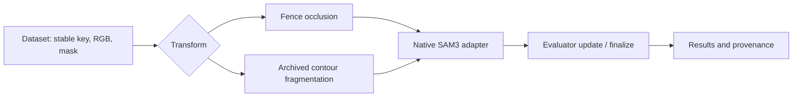

# Lab proposal: segmentation through fences and fragmented contours

Draft outline, 2026-10-15. Controlled quantitative experiments are planned.

---

## 1. Which visible pieces belong to the same animal?

- Lead visual: original donkey-behind-fence example, with a clear source credit.
- Show input and individual SAM3 proposals side by side; label prompt location,
  candidate ID, and predicted IoU. Do not imply the overlay is one segmentation.
- Motivation: fences split a coherent object into several visible regions.
- Speaker point: related challenges include foliage and crowds of similar animals.

---

## 2. Research question and connection to fragmentation

“How does fragmentation and occlusion affect object segmentation in SAM3, and can we improve its robustness?”

- Visual progression: natural fence → controlled synthetic bars → fragmented
  white contours with matched background/noise segments.
- Both remove boundary evidence, but one preserves natural texture and the other
  isolates sparse boundary structure. Treat them as distinct experimental arms.
- Ask whether robustness transfers between these conditions; do not assume it.

---

## 3. What currently works, and what the examples show

- Native Meta SAM3 runs on Vulcan via SLURM; existing seven-image job took 49 s.
- Automatic 3×3 grid: nine independent positive-point prompts, multiple masks
  per prompt. This is automatic grid prompting, not prompt-free segmentation.
- Donkey: some proposals capture animal parts; some merge animal and fence.
- Portrait: person-related proposals despite shadows; illumination differs
  from physical occlusion.
- These observations motivate controlled testing; they are not quantitative
  proof of contour integration or a localized encoder/decoder failure.

---

## 4. A small, inspectable pipeline

- Dataset uses `__len__` / `__getitem__`; transforms work with Compose.
- Original mask is retained; fence visible and occlusion masks are separate.
- Frozen contour geometry/noise remains available alongside the old main code.
- Software tests check alignment and preservation, not scientific validity.

---

## 5. Planned clean / light / medium / heavy comparison

- Start with the same image and annotation for each condition.
- Fence widths 0 / 4 / 12 / 24 px at fixed spacing 40 px are initial software
  defaults, not scientifically calibrated severity categories.
- Fix angle and phase/seed across conditions so occlusion is nested; report
  actual object coverage rather than only nominal bar width.
- Keep contour noise/fragmentation settings in a separate arm; preserve its
  historical behavior before investigating corrected variants.
- Freeze source-image splits and mask-selection protocol before quantification.
- Next experiment follows refactor review and approved merge, with GPU approval.

---

## 6. Visible segmentation versus hidden-region completion

- Show three aligned panels: source mask, bar mask, visible target.
- Visible target = source mask minus synthetic occlusion; full target = source
  mask before adding bars.
- A visible-only result may segment exposed regions well without completing
  hidden regions. Full-target overlap alone needs careful interpretation.
- COCO visible annotations do not establish genuine amodal shape behind natural
  occluders; investigate an amodal annotation source for that claim.
- Separate model-score choice from oracle best-mask IoU, labeled an upper bound.
- Common-visible positive prompts are a separate controlled evaluation protocol
  from the automatic scene-wide grid.

---

## 7. Future: representation or mask decoding?

- After a reproducible baseline, inspect features and decoder behavior.
- Candidate tests: frozen-encoder decoder fine-tuning; feature probes on matched
  clean/corrupted images; comparison across vision encoders.
- Improvement after decoder training is evidence of useful recoverable features;
  it does not by itself prove all failures originate only in the decoder.
- Deliverable now: safe refactor and reviewable pipeline; no new training result.

---

## References and discussion

- Project: https://github.com/venniseho/bw-lab-project-2025
- Log: https://docs.google.com/document/d/1Jh1bZ4EN473fMY0mR8LZzR4dBOX_XixAOIBk6ac92lc
- Prior report: https://docs.google.com/document/d/1mQrYGKPKZ44tVxhy-GtNIQdZE1FF7ZA91ec0WD_aSHA
- Architecture reference: https://github.com/mtangemann/mlvbench/tree/c204a8185fb662b3b1edacfb7a98f7b36fbd9a70
- Native SAM3: https://github.com/facebookresearch/sam3
- Related robustness code: https://github.com/hendrycks/robustness
